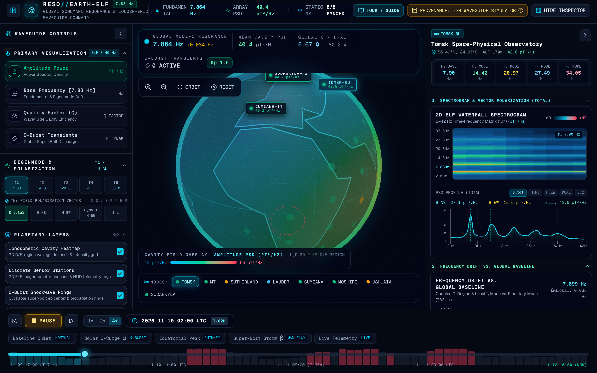
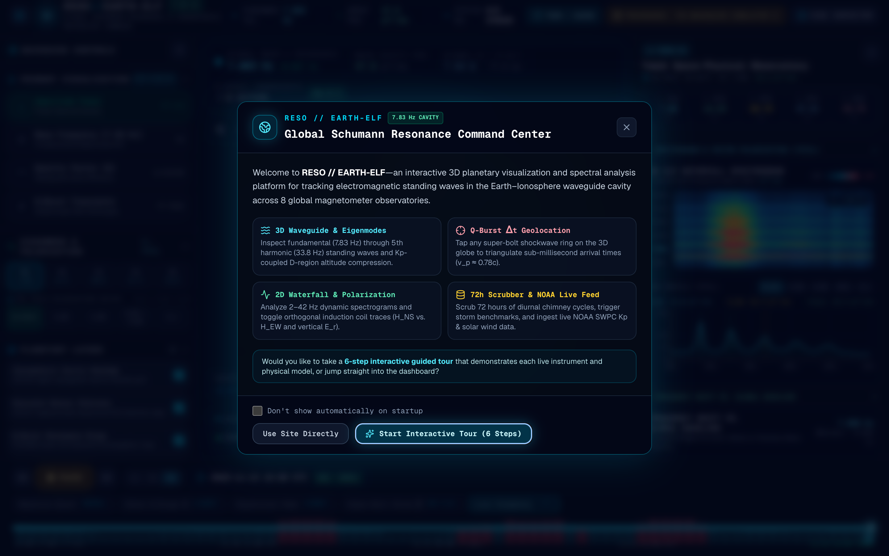
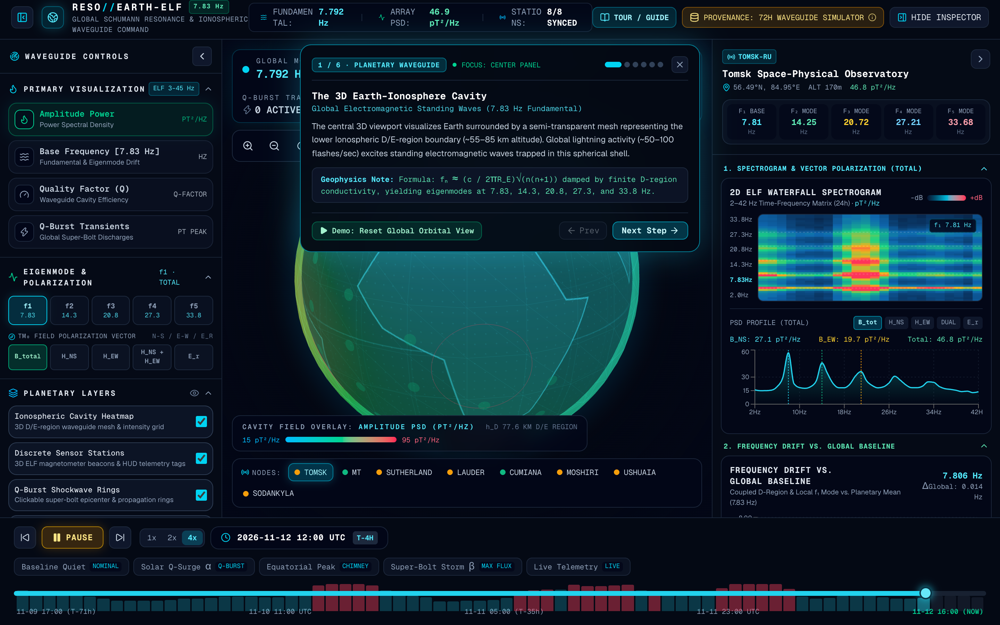
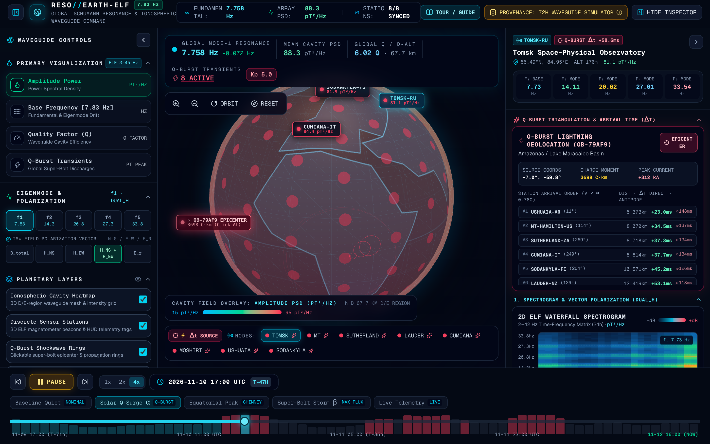
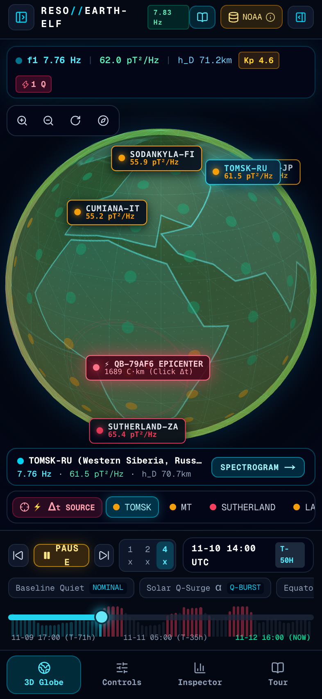

<div align="center">

# 🌍⚡ RESO // EARTH-ELF

### Global Schumann Resonance (7.83 Hz) & Ionospheric Waveguide Command Center

[](https://awerds.github.io/resohub/)
[](https://nextjs.org/)
[](https://threejs.org/)
[](https://www.swpc.noaa.gov/)

**An interactive 3D planetary telemetry and spectral analysis platform for visualizing Extremely Low Frequency (ELF, 3–45 Hz) electromagnetic standing waves trapped inside the Earth–Ionosphere cavity.**

[**🚀 Launch Live Command Center →**](https://awerds.github.io/resohub/)

</div>

---



---

## 📖 Overview: What is the Schumann Resonance?

Every second, roughly **50 to 100 lightning discharges** flash across the planet—concentrated in three major equatorial thunderstorm "chimneys" (**Amazon Basin**, **Congo Basin**, and the **Maritime Continent / Indonesia**).

These lightning strokes act as massive vertical dipole antennas that launch **Extremely Low Frequency (ELF)** electromagnetic waves into the spherical shell bounded by the conductive Earth surface below and the ionized **D/E-region of the ionosphere** ($\sim 55\text{–}85\text{ km}$ altitude) above. Because the Earth's circumference ($\sim 40,075\text{ km}$) is approximately equal to one wavelength of a $7.83\text{ Hz}$ radio wave, waves constructively interfere as they circumnavigate the globe, ringing the Earth–ionosphere cavity at discrete harmonic eigenmodes:

$$f_n \approx \frac{c}{2\pi R_E}\sqrt{n(n+1)} \quad \xrightarrow{\text{D-region damping}} \quad f_1 \approx 7.83\text{ Hz},\; f_2 \approx 14.3\text{ Hz},\; f_3 \approx 20.8\text{ Hz},\; f_4 \approx 27.3\text{ Hz},\; f_5 \approx 33.8\text{ Hz}$$

**RESO // EARTH-ELF** brings this invisible planetary field to life—combining **live NOAA Space Weather Prediction Center (SWPC)** satellite feeds ($Kp$-index and L1 solar wind) with a coupled spherical Earth–ionosphere waveguide solver across **8 global magnetometer observatories**.

---

## 🖼️ Platform Visual Tour & Screenshots

### 1. Startup Mission Briefing & 6-Step Interactive Guided Tour
When you first launch the site (or click **`TOUR / GUIDE`** in the top header at any time), a native `<dialog>` Mission Briefing lets you either jump straight into the controls or launch a **6-step interactive guided tour** that automatically configures and demonstrates each subsystem with real-time geophysical notes.

| Startup Mission Briefing Popup | Interactive 6-Step Guided Tour HUD |
| :---: | :---: |
|  |  |

---

### 2. Q-Burst Super-Bolt Triangulation ($\Delta t$) & Orthogonal Vector Spectrograms
During intense **"Super-Bolt" lightning transients** (Charge Moment $> 1,000\text{ C}\cdot\text{km}$), ELF $\text{TM}_0$ shockwaves propagate around the planet at $v_p \approx 0.78c$ ($\sim 233,838\text{ km/s}$). Clicking any crimson Q-Burst epicenter ring on the 3D globe or hitting **`⚡ Δt SOURCE`** triangulates sub-millisecond arrival times ($\Delta t$) and antipodal echoes across all 8 stations while plotting dual orthogonal magnetic induction coils ($H_{\text{NS}}$ vs. $H_{\text{EW}}$).



---

### 3. Dedicated Touch-First Mobile Experience
On phones and compact viewports (`< 1024px`), **RESO // EARTH-ELF** automatically adapts into a full-viewport 3D WebGL globe with a **4-tab bottom thumb dock** (`3D Globe`, `Controls`, `Inspector`, `Tour`), slide-over drawers, and a 1-tap active station telemetry pill.

<div align="center">
  
</div>

---

## 🧭 User Guide: How to Explore the Command Center

### 🎛️ Left Drawer: Waveguide Controls & Sensor Array
1. **Primary Visualization Mode (`ELF 3–45 Hz`):**
   * **Amplitude Power ($\text{pT}^2/\text{Hz}$):** Maps Power Spectral Density across the 3D ionospheric cavity shell and station beacons.
   * **Base Frequency ($7.83\text{ Hz}$):** Visualizes positive and negative frequency drift ($\Delta f$) driven by D-region conductivity shifts.
   * **Quality Factor ($Q$):** Displays waveguide cavity resonance efficiency ($Q \approx 4.0\text{–}10.5$).
   * **Q-Burst Transients ($\text{pT}$ Peak):** Highlights global super-bolt lightning discharges and shockwave rings.
2. **Eigenmode & Vector Polarization Selector:**
   * Isolate any of the 5 Schumann harmonics: **$f_1$ ($7.83\text{ Hz}$)**, **$f_2$ ($14.3\text{ Hz}$)**, **$f_3$ ($20.8\text{ Hz}$)**, **$f_4$ ($27.3\text{ Hz}$)**, or **$f_5$ ($33.8\text{ Hz}$)**.
   * Switch $\text{TM}_0$ electromagnetic field polarization between **`B_total`** (scalar horizontal magnetic PSD), **`H_NS`** (North–South induction coil), **`H_EW`** (East–West induction coil), **`H_NS + H_EW`** (dual orthogonal trace overlay), and **`E_r`** (radial vertical electric whip in $\text{mV}^2/\text{m}^2/\text{Hz}$).
3. **Planetary Layers:**
   * Toggle the **Ionospheric Cavity Heatmap** (3D vertex-colored D/E-region shell), **Discrete Sensor Stations**, **Q-Burst Shockwave Rings**, **Phase Coherence Links**, and **Magnetospheric Limb Halo**.

---

### 📊 Right Drawer: Station Spectrogram & Coupled D-Region Inspector
* **5-Harmonic Eigenmode Strip:** Instantaneous readout of $f_1\text{–}f_5$ frequencies for the selected observatory.
* **Q-Burst Triangulation & Arrival Time ($\Delta t$) Matrix:** Ranks all 8 observatories by great-circle distance from the active super-bolt epicenter, displaying direct arrival time ($\Delta t$ in $\text{ms}$), round-the-world antipodal echo time, and azimuthal bearing.
* **2D ELF Waterfall Spectrogram (`2–42 Hz`):** 24-hour rolling time-frequency heatmap with a synchronized cursor and instantaneous Lorentzian harmonic PSD profile below it.
* **Frequency Drift vs. Global Baseline:** Dual-line chart comparing the selected station's local $f_1$ drift against the 8-station planetary mean.
* **Coupled D-Region & Ionospheric Telemetry:** Tracks downward **D-region boundary compression** ($h_D$ from $\sim 80.1\text{ km}$ during quiet conditions down to $\sim 55\text{–}60\text{ km}$ during severe $Kp \ge 8$ solar storms), L1 solar wind speed, local lightning flash rate, and surface meteorology.

---

### ⏱️ Bottom Bar: 72-Hour Timeline Scrubber & Scenario Presets
* **2x Default Time-Lapse Playback & Active Orbital Rotation:** Launches animated at `2x` speed with 3D globe orbital rotation active by default so you can immediately watch the 3 equatorial thunderstorm chimneys sweep around the globe over a 72-hour window.
* **Scenario Benchmark Presets:**
  * **`Baseline Quiet (NOMINAL)`:** Undisturbed reference state ($Kp = 1.2$, $h_D \approx 80.1\text{ km}$, 0 Q-bursts).
  * **`Solar Q-Surge α (Q-BURST)`:** Moderate geomagnetic activation ($Kp = 5.0$, $h_D \approx 66.3\text{ km}$) with active Q-burst transients.
  * **`Equatorial Peak (CHIMNEY)`:** Diurnal UTC peak across the Amazon / Maritime Continent lightning chimneys.
  * **`Super-Bolt Storm β (MAX FLUX)`:** Severe geomagnetic storm ($Kp = 8.7$, $h_D \approx 60.1\text{ km}$, 8 active Q-bursts, strong auroral compression at Sodankylä).
  * **`Live Telemetry (LIVE)`:** Locks onto the current UTC hour (`NOW`) coupled with live NOAA SWPC space weather.

---

## 📡 Global ELF Magnetometer Observatory Array

| Station ID | Observatory Name | Region | Coordinates | Alt | Instrumentation |
| :--- | :--- | :--- | :--- | :--- | :--- |
| **`TOMSK-RU`** | Tomsk Space-Physical Observatory | Western Siberia, Russia | `56.49°N, 84.95°E` | `170m` | Induction Coil Magnetometer (N-S / E-W) |
| **`MT-HAMILTON-US`** | Lick / Mt. Hamilton ELF Site | California, USA | `37.34°N, 121.64°W` | `1283m` | Tri-Axial Search-Coil Magnetometer |
| **`SUTHERLAND-ZA`** | SAAO Sutherland Geomagnetic | Northern Cape, South Africa | `32.38°S, 20.81°E` | `1758m` | Superconducting ELF Squid Array |
| **`LAUDER-NZ`** | NIWA Lauder Atmospheric | Central Otago, New Zealand | `45.04°S, 169.68°E` | `370m` | Vertical Electric Whip + Dual Coils |
| **`CUMIANA-IT`** | Cumiana ELF Monitoring Station | Piedmont, Italy | `44.98°N, 7.38°E` | `380m` | Ultra-Low Noise Induction Receiver |
| **`MOSHIRI-JP`** | Moshiri Observatory (Nagoya U.) | Hokkaido, Japan | `44.37°N, 142.26°E` | `290m` | Orthogonal Search-Coil + Ball Antenna |
| **`USHUAIA-AR`** | Austral Tierra del Fuego Node | Patagonia, Argentina | `54.80°S, 68.30°W` | `42m` | Sub-Antarctic ELF Waveguide Sensor |
| **`SODANKYLA-FI`** | Sodankylä Geophysical Obs. | Lapland, Finland | `67.37°N, 26.63°E` | `179m` | Auroral Cavity Search-Coil Array |

---

## 🛰️ Data Provenance: Live NOAA SWPC + Coupled Waveguide Model

Click the **`PROVENANCE`** badge in the top-right header at any time to inspect the [`TelemetrySourceAdapter`](./src/lib/telemetry-adapter.ts):

1. **Live Satellite Space Weather Ingestion (`services.swpc.noaa.gov`):**
   * Fetches real-time **NOAA Planetary $Kp$-Index** (`noaa-planetary-k-index.json`) and **DSCOVR L1 Solar Wind** speed & proton density (`solar-wind/plasma-5-minute.json`) on startup and every 5 minutes—requiring **zero API keys**.
2. **Coupled Spherical Waveguide Physics (`src/lib/schumann-data.ts`):**
   * Real-time $Kp$ and solar wind values are fed into our 72-hour spherical Earth–ionosphere waveguide model, dynamically compressing the D-region boundary height ($h_D$), shifting harmonic eigenfrequencies ($f_1\text{–}f_5$) and $Q$-factors (with $1.42\times$ auroral amplification at high-latitude stations), and generating vector polarization spectra ($H_{\text{NS}}, H_{\text{EW}}, E_r$).

---

## 🛠️ Tech Stack & Local Development

* **Framework:** Next.js 16 (App Router, Static Export) + React 19 + TypeScript
* **3D Planetary Engine:** `react-globe.gl` + custom `Three.js` vertex-colored ionospheric cavity mesh & procedural 2048×1024 dark-mode geomagnetic textures
* **Spectral Charts:** `Recharts` + custom HTML5 Canvas 2D waterfall spectrogram
* **State Management:** `Zustand`

```bash
# Install dependencies
npm install --legacy-peer-deps

# Start local development server (http://localhost:3000)
npm run dev

# Build static production bundle (./out)
npm run build

# Deploy to GitHub Pages (gh-pages branch)
npm run deploy
```
